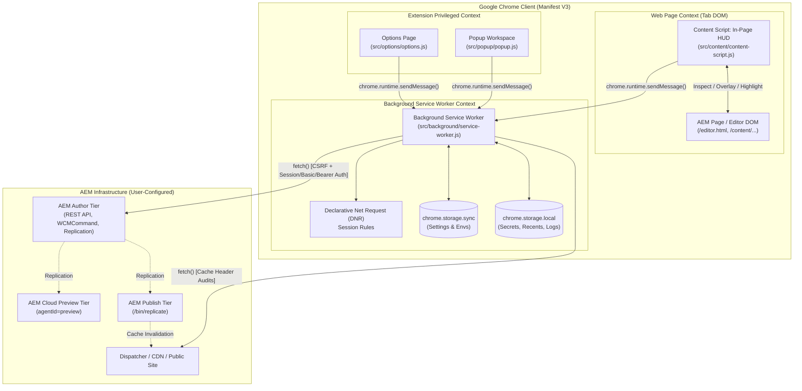

# High-Level Design (HLD) — AEM Orbit

**Document Version:** 1.0.0-beta  
**Target Platform:** Google Chrome (Manifest V3)  
**Target Systems:** Adobe Experience Manager (AEM as a Cloud Service & AEM 6.5)

---

## 1. Introduction & Objectives

### 1.1 Purpose
This High-Level Design (HLD) defines the software architecture, system boundaries, security model, and integration patterns for **AEM Orbit**, a Chrome extension designed to streamline authoring, developer operations, and content governance across AEM Cloud and AEM 6.5 environments.

### 1.2 Architectural Goals
- **Context Isolation & Security:** Adhere strictly to Chrome Manifest V3 security boundaries; isolate sensitive credentials from untrusted web page DOM contexts.
- **Least-Privilege Host Access:** Avoid blanket `<all_urls>` host permissions; request and bind permissions dynamically only to user-configured domains.
- **Environment Agility:** Provide seamless, one-click tier navigation (Author ↔ Preview ↔ Publish ↔ Dispatcher/CDN) and multi-environment synchronization (Local ↔ Dev ↔ Stage ↔ Prod).
- **High Performance & Zero Runtime Bloat:** Utilize native ES modules, lightweight functional architecture, and modern build tooling (`esbuild`) with zero heavy runtime framework dependencies.

---

## 2. System Context & Architecture



---

## 3. Subsystem Breakdown

### 3.1 In-Page Content Script (HUD Toolbar)
- **Role:** Injected into authorized AEM author, preview, publish, and dispatcher web pages.
- **Responsibilities:**
  - Renders a floating, draggable bottom toolbar pill with site-specific position persistence.
  - Displays real-time replication status (`Published`, `Draft`, `Modified`) and preview tier pills.
  - Hosts the Component Inspector, JCR Tree visualizer, editable region highlighter, and Command Palette (`⌘+K`).
  - Offers one-click **Edit / View / Live / Props** on the minimised bar, and Tier, Publish and Locales menus on the expanded bar. Locale and live-copy rows open in the same tier and view mode as the current page.
  - Places the buttons on each bar from a saved layout (default: the built-in layout). Buttons removed from the expanded bar move into the More menu and stay in the Command Palette.
  - Dispatches user actions to the background service worker via asynchronous message passing.

### 3.2 Extension Workspace Popup
- **Role:** Standalone extension action UI accessible from the browser toolbar.
- **Responsibilities:**
  - Displays current page metadata, status details, and quick bookmarking (`★`).
  - Offers the same **Edit / View / Live / Props** one-click actions as the toolbar, and live search that can point the popup at another page (with a note and a back button).
  - **Developer Mode gating:** the *Developer Tools* group (JCR, CRXDE Lite, Overlays, Delete, Sync) is shown only when Developer Mode is on, and each button follows its per-button setting. Versions, Save Version and Copy URLs sit in *Workspace* and move into *Developer Tools* while it is shown.
  - **Environment Compare:** Computes and renders SHA-256 canonical content drift across all configured tiers.
  - **Version History & Checkpoints:** Lists Oak version trees and triggers checkpoint creations.
  - **Bulk Replication:** Validates and executes batch publication/unpublication for up to 200 paths.
  - **Quick Links:** Deep-links to Sites, Assets, CRXDE Lite, OSGi Consoles, and Cloud Manager.
  - **Action Audit Log:** Displays and exports device-local CSV action logs.

### 3.3 Options & Configuration Engine
- **Role:** Privileged configuration panel for managing environments and feature toggles.
- **Responsibilities:**
  - Supports default environments (`local`, `dev`, `stage`, `prod`) and dynamic custom environments.
  - Configures authentication methods (`Browser Session`, `Basic`, `Bearer IMS`, `None`).
  - Requests dynamic Chrome host permissions (`chrome.permissions.request`) upon domain configuration.
  - Manages Dispatcher-to-JCR prefix URL mappings.
  - Tracks unsaved changes (sticky header note and a `beforeunload` guard) and offers settings export / import as JSON. Export never contains credentials, and import only fills the form until the user saves.
  - Offers an opt-in **Allow syncing to higher environments** safety setting. By default, page sync only copies from a higher environment to a lower one (by the configured environment order). The service worker's API layer enforces this too, not only the menu.
  - Lets the user choose and order the buttons on the regular and expanded toolbar (**Toolbar** section, opt-in through a *Customise toolbar buttons* switch). The layout is validated by a shared pure module, capped per bar, and never allows Delete or Unpublish as one-click buttons.
  - Provides a **floating orb** style enabled by default for the regular bar (with a *Use classic horizontal bar when collapsed* setting to switch back). Hovering it fans out a half ring of pointed leaves, icon above label: a fixed set (Edit, View, Live, Environment in the middle, JCR or Copy path, Props, Sites), where the Environment leaf swaps the fan for the environments (or opens the dropdown above the orb for 1 or more than 6); the geometry is a shared pure module (`orb-layout.js`).
  - Sets `data-asp-theme` (`light` / `dark`) on `<html>` through `syncTheme()` (`shared/theme-dom.js`) from the Settings theme choice `optionsTheme` (`auto` follows the browser theme, and changes with it). The toolbar, orb, popup, Settings page and shared dialogs all key their light styles on it instead of `prefers-color-scheme`.

### 3.4 Background Service Worker (API Broker)
- **Role:** Privileged background broker executing all network calls and enforcing security policies.
- **Responsibilities:**
  - Routes messages and executes AEM REST API calls (15s timeout, CSRF token attachment, up to two retries with backoff for GETs on a network error or 502/503/504).
  - Dynamically registers content scripts on authorized origins using `chrome.scripting`.
  - Configures `chrome.declarativeNetRequest` session rules for Sling Referrer filter validation.
  - Validates typed confirmation tokens for protected environments before any replication (publish, unpublish, publish to preview), destructive action or sync undo, and refuses Sync unless Developer Mode and its Sync button are on.
  - Keeps the last 5 pre-sync copies of target pages in `chrome.storage.local` so a sync can be undone, and offers read-only previews (content diff between environments, tree-publish dry run).
  - Returns only a generic message to the UI when a handler throws (details stay in the service-worker console), and shows desktop notifications for completed actions unless turned off in Settings.

---

## 4. Security Architecture & Data Flow

```mermaid
flowchart LR
    subgraph Untrusted["Untrusted In-Page Context"]
        ContentScript["Content Script (HUD)\n- Strict CSP\n- No Access to Secrets\n- DOM Text Escaping"]
    end

    subgraph Boundary["Privileged Message Router"]
        Router["Service Worker Router\n- sender.id Verification\n- Protected Env Guard\n- Sanitized Configs"]
    end

    subgraph Secure["Protected Storage & APIs"]
        Secrets[("chrome.storage.local\n(Device-Only Secrets)")]
        AEM["AEM Author REST APIs\n- CSRF Protection\n- 15s AbortSignal\n- DNR Referer Spoofing"]
    end

    ContentScript -->|Structured Message| Router
    Router -->|Read Credentials| Secrets
    Router -->|Privileged fetch()| AEM
```

### 4.1 Credential & Secret Segregation
- **Browser Session Auth (Default):** Reuses the browser's existing AEM login cookie (`credentials: 'include'`). No credentials are saved.
- **Local Storage Isolation:** Basic auth passwords and Bearer tokens are stored exclusively in `chrome.storage.local` (device-only, never synchronized across Google accounts).
- **Public Config Redaction:** Content scripts and popups receive sanitized configs via `getPublicConfig()`, which strips all secrets and provides only a boolean `hasCredentials` indicator.

### 4.2 Cross-Origin & CSRF Protection
- **Declarative Net Request (DNR) Rules:** AEM's `SlingReferrerFilter` rejects cross-origin `POST`/`PUT`/`DELETE` calls without valid `Referer` headers. Dynamic DNR session rules rewrite `Referer` and `Origin` headers to match the target author host for extension-initiated calls.
- **CSRF Token Injection:** All state-changing requests automatically fetch and attach tokens from `/libs/granite/csrf/token.json`.

---

## 5. Technology Stack & Design Decisions

| Category | Technology Selection | Architectural Rationale |
|---|---|---|
| **Architecture Paradigm** | Modular Functional (ESM) | Stateless, optimal for MV3 service worker lifecycles, zero `this` binding issues. |
| **Bundling Toolchain** | `esbuild` (Target: `chrome116`) | Sub-10ms build times, clean IIFE output for content scripts, native ESM for worker. |
| **Testing Framework** | Native Node.js Test Runner (`node --test`) | Zero testing dependencies, runs in sub-100ms, pure functional testability. |
| **Styling & UI** | Scoped CSS (`.asp-` namespace) | Prevents CSS leakage into host AEM author and client website layouts. |
| **Accessibility Standard** | WAI-ARIA Modal Dialog Pattern | Focus trapping, Escape key handlers, full keyboard navigation. |
