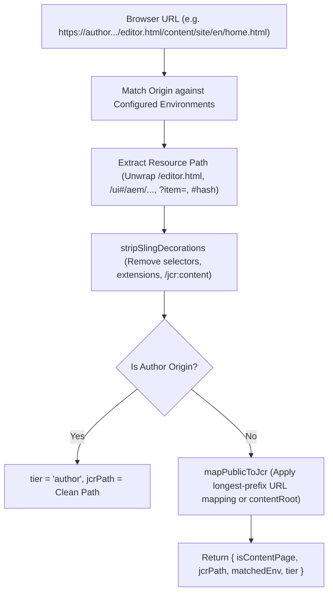
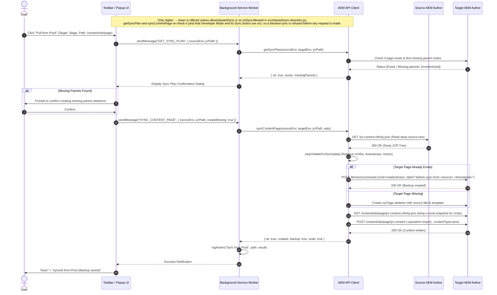

# Low-Level Design (LLD) — AEM Orbit

**Document Version:** 1.0.0-beta  
**Target Platforms:** Chromium (MV3), Firefox (`>=115` MV3 via `background.scripts`), Safari Web Extensions  
**Modules:** Browser Compat Layer, Persona Engine, Background Router, AEM API Client, URL Engine, Page Audit Engine, UI Action Controllers, Dialogs

---

## 1. Module Specifications & Interfaces

### 1.1 Storage Data Models

```typescript
interface EnvironmentConfig {
  label: string;              // Display label for custom envs
  authorHost: string;         // e.g. "https://author-p123-e456.adobeaemcloud.com"
  publishHost: string;        // e.g. "https://publish-p123-e456.adobeaemcloud.com"
  previewHost: string;        // e.g. "https://preview-p123-e456.adobeaemcloud.com"
  dispatcherHost: string;     // e.g. "https://www.example.com"
  dispatcherOmitHtml: boolean;   // "Omit .html on Dispatcher / CDN URLs" checkbox. Default false
  publishUsesMappings: boolean;  // "Apply URL mapping to Publish / Preview" checkbox. Default false: Publish/Preview URLs use the full JCR path
  authType: 'session' | 'basic' | 'bearer' | 'none';
  protected: boolean;         // Enforce typed confirmation before publish/unpublish/delete/bulk/sync
  username?: string;          // Stored in chrome.storage.local only
  password?: string;          // Stored in chrome.storage.local only
  bearerToken?: string;       // Stored in chrome.storage.local only
  hasCredentials?: boolean;   // Expose to UI (sanitized)
}

interface ExtensionConfig {
  envOrder: string[];         // Ordered array of env keys
  environments: Record<string, EnvironmentConfig>;
  contentRoot: string;        // Default fallback JCR root (e.g. "/content/mysite")
  appName: string;            // Apps folder for CRXDE deep links
  urlMappings: string;        // Multi-line mapping "/content/site/en = /en"
  showOnAuthor: boolean;
  showOnPublish: boolean;
  showOnDispatcher: boolean;
  confirmDelete: boolean;
  confirmPublish: boolean;    // Safety: false (default). Protected envs always confirm Publish / Unpublish / To Preview; true also asks on the others
  allowUpwardSync: boolean;   // Safety: false (default) = Sync only copies from a higher env to a lower one
  enableKeyboardShortcut: boolean;
  showLastModified: boolean;
  persona: 'author' | 'qa' | 'dev' | 'custom'; // 'custom' preserves legacy defaults
  enableDevMode: boolean;
  devToolsButtons: {
    jcr: boolean;
    overlays: boolean;
    highlight: boolean;
    inspect: boolean;
    tools: boolean;
    reload: boolean;
    delete: boolean;
    sync: boolean;            // Sync content is a developer feature: needs enableDevMode and this flag
  };
  qaToolsButtons: {           // Opt-in in 'custom'; enabled via 'qa'/'dev' presets
    audit: boolean;
    cache: boolean;
    readiness: boolean;
  };
  profiles: Record<string, { label: string; contentRoot: string; appName: string; matchDomains?: string[]; urlMappings?: string }>;
  activeProfile: string | null;
  customSnapshot: object | null; // Preserved custom checkboxes when previewing presets
  classicBar: boolean;        // Opt-in: show the classic horizontal minimized bar instead of the default floating orb (default false)
  summonOnLongPress: boolean; // Opt-in, needs floating orb: press and hold on the page to open the orb at the pointer (default false)
  customizeToolbar: boolean;  // Opt-in: use toolbarLayout instead of the built-in toolbar (default false)
  // Buttons on the regular and expanded toolbar. null = the built-in layout. Kept while customizeToolbar is off.
  toolbarLayout: { mini: string[]; expanded: string[] } | null;
}

interface ActionLogEntry {
  ts: number;
  env: string;
  action: string;
  path: string;
  count?: number;
  ok: boolean;
  error?: string;
}

// chrome.storage.local.syncSnapshots — the last 5 pre-sync copies of target pages (for Undo)
interface SyncSnapshot {
  env: string;        // target environment
  path: string;       // page path
  sourceEnv: string;
  ts: number;
  content: object;    // the target's jcr:content before the sync (volatile properties stripped)
}
```

`notifyOnActions` (boolean, default `true`, in `chrome.storage.sync`) controls the desktop notification after a successful action. The action log is written either way.

`requestTimeoutSec` (number, default 15, clamped to 5–120, in `chrome.storage.sync`) sets the timeout used by `aemRequest`.

`sessionOnlyCredentials` (boolean, default `false`, in `chrome.storage.sync`) moves `secrets` from `chrome.storage.local` to `chrome.storage.session` (memory only, cleared when the browser closes). The Settings page writes them to one area only and removes them from the other. `getConfig()` merges both, so the rest of the code is unaware of the difference.

---

## 2. Core Subsystem Implementations

### 2.1 URL & Tier Resolution Engine (`src/shared/url-utils.js`)

#### 2.1.1 Path Extraction & Normalization
The engine parses browser URLs, strips author consoles, and maps public vanity paths to JCR paths:



#### Key Functions
- `stripSlingDecorations(resPath: string): string`  
  Removes selectors, extensions, suffixes, and paths under `jcr:content` (e.g., `/content/site/page.model.json/suffix` → `/content/site/page`).
- `parseMappings(text: string): Array<{jcr: string, pub: string, exact?: true}>`  
  Parses one rule per line, ignoring comments (`#`) and invalid lines. `<jcrPrefix> = <publicPrefix>` maps the page and everything below it. `<jcrPath> == <publicPath>` (`exact: true`) maps exactly that page and never its children, which covers a home page the site redirects to (`/content/site/us/en/homepage == /`). Wildcards are deliberately not supported: a pattern such as `/*-*` would also match unrelated hyphenated URLs (`/cloud-computing`), and a strict locale pattern would reject real locales such as `zh-hans`. List each locale on its own line instead. Lines containing `*` are dropped.
- `mapPublicToJcr(publicPath: string, mappings: Array, contentRoot: string): string | null`  
  Resolves dispatcher URLs (e.g., `/en/home`) back to JCR paths (`/content/site/en/home`). Rules are tried most specific first: `==` rules before prefix rules, then the longer path, then the order written. Falls back to `contentRoot + path`.
- `mapJcrToPublic(jcrPath: string, mappings: Array): string`  
  The reverse, with the same ordering. Returns the JCR path unchanged when nothing matches.
- `sameTierUrl(variants, tier, inEditor, wcmDisabled = false): string`  
  Picks the URL variant for the tier the user is on. On Author: `authorEditUrl` in the editor, `authorDisabledUrl` when the page is in view mode (`?wcmmode=disabled`), otherwise `authorTouchUrl`. Publish, Preview and Dispatcher return their own variant.
- `parseMsmPath(jcrPath): { kind: 'master' | 'livecopy', siteRoot, lang, region?, relPath } | null`  
  Recognises `/content/<site>/language-masters/<lang>/…` and `/content/<site>/<region>/<lang>/…`.

#### URL variants (`getUrlVariants` in `src/shared/aem-api.js`)
Besides the Author, Publish, Preview and Dispatcher URLs, `getUrlVariants` returns `authorDisabledUrl` (View) and `liveUrl`: the Dispatcher / CDN URL when a CDN host is set, otherwise the Publish URL.

A default locale served without a prefix is configured as a mapping to `/` (`/content/site/us/en = /`): longest-prefix matching keeps `/de-de/...` on its own mapping, and `/products` resolves to `/content/site/us/en/products`. Without such a line a prefix-less public path falls back to `contentRoot + path`, which has no locale.

URL mappings (`urlMappings`) are dispatcher / CDN rewrites, so they are applied as follows: the Dispatcher URL and a `liveUrl` built on the Dispatcher host always use the mapped public path. Publish and Preview URLs (and a `liveUrl` that falls back to the Publish host) use the mapped path only when the environment's `publishUsesMappings` checkbox ("Apply URL mapping to Publish / Preview") is on, otherwise the full JCR path. It is off by default, because a publisher without a dispatcher only serves full `/content/...` paths. The Dispatcher URL and a `liveUrl` on the Dispatcher host get `.html` unless the environment's `dispatcherOmitHtml` checkbox ("Omit .html on Dispatcher / CDN URLs") is on, for sites that serve extension-less URLs; Publish and Preview URLs follow the same checkbox only when `publishUsesMappings` is on (they are then behind a dispatcher/CDN); otherwise they keep it, because a bare publisher needs it (`buildPageUrl(host, path, { html })`). Author URLs always use the JCR path. In the other direction `parsePageUrl` accepts both the full `/content/...` path and the mapped path on any publish host, so it needs no setting.

---

### 2.1b Toolbar Layout (`src/shared/toolbar-layout.js`)

Pure module imported by both the content script (applies the layout) and the options page (edits it).

- `TOOLBAR_ITEMS`: the registry. Each item has `id`, `label`, `elId` (the toolbar button's element id), `group`, `icon` (SVG path), and optional `dev` (Developer Mode key), `qa` (QA Verification key: `audit` or `cache`), `required` and `overflow`. Delete and Unpublish are not in it, so they can never be placed on a bar.
- `defaultLayout()`: the toolbar as it shipped. Regular: Edit, View, Live, Props. Expanded: Tier, Publish, Locales | Sites, Sync, Inspect, JCR, More | palette hint, Copy path, Settings. When active persona is `author`, `qa`, or `dev`, `PERSONA_LAYOUTS[persona]` overrides the layout automatically (`custom` uses `defaultLayout()` or `toolbarLayout` when `customizeToolbar` is enabled).

### 2.1a Workspace Personas & Cross-Browser Compatibility (`src/shared/persona.js`, `src/shared/browser-compat.js`)

- **`persona.js` (pure):** Defines `PERSONAS = ['author', 'qa', 'dev', 'custom']`, `PERSONA_DEFS`, `PERSONA_LAYOUTS`, `resolvePersonaState(config)`, `allowedPersonasForConfig(config)`, and `isPersonaToolEnabled(state, key)`. `custom` keeps legacy defaults (replication on, `qaToolsButtons` opt-in off unless checked, optional `enableDevMode` & custom toolbar layout); `qa` enables SEO audit, cache headers, QA Readiness, highlight, inspect, and reload while hiding publishing & JCR mutations (`readOnlyJcr: true`); `dev` enables all developer + QA tools; `author` streamlines controls for content authors. Managed policies `defaultPersona`, `allowedPersonas`, and `disabledControls: ['developerMode']` filter and enforce permitted personas in `getConfig()` and the UI.
- **`browser-compat.js`:** Abstracts WebExtension namespaces (`globalThis.browser` Promises vs `globalThis.chrome` callbacks), normalizes `compatStorageGet/Set/Remove/Clear` (gracefully handling absent `managed`/`session` areas in Safari/Firefox while rejecting real sync/local errors), wraps `permissions.contains` before `permissions.request` in `requestOriginsCompat()`, and provides `createTimeoutSignal()`, `copyToClipboard()`, `notifyCompat()`, and `reloadTabCompat()`. `scripts/build.mjs --firefox` compiles a Firefox MV3 target into `dist/firefox/` using `background.scripts`.

### 2.1b Viewport-Bounded Floating Windows (`fitFloatingBox` in `src/content/content-script.js`)

- Long menus (Locales with MSM live copies + hreflang lists, Env Picker, More menu) and panels (JCR Tree, SEO Audit, Cache Headers, Component & DAM cards) run through `fitFloatingBox(box, refRect, { alignLeft, preferredMaxH })`: constrains `maxHeight` to viewport margins (`12px`), centers vertically on compact screens when neither space above nor space below the toolbar fits natural height, and delegates overflowing items to internal `overflow-y: auto` (`scrollbar-width: thin`) containers (`.asp-menu-items`, `.asp-float-body`, `#asp-inspector-body`).
- `normalizeLayout(saved)`: drops unknown ids and duplicates, falls back to the default for a missing or unusable bar, always keeps `more` and `settings` on the expanded bar, and applies `MAX_ITEMS` (6 regular, 14 expanded) without dropping required items.
- `isDefaultLayout(layout)`: the options page stores `null` for the default, so items added in a later version still reach people who never customised.
- `layoutRuns(ids)`: splits the ids into runs of the same `group`; the toolbar draws a divider before each run.
- `overflowItems(layout)`: items with `overflow` that are not on the expanded bar. `openMoreMenu` lists them under "Removed from the toolbar".

**Applying it (`content-script.js`).** `buildToolbar` still creates every button once and handlers are bound by element id. `placeItems()` runs from `applyMinimized()`: it parks every registry button in the hidden `#asp-pool`, clears the active cluster, then re-parents the chosen buttons in saved order, inserting dividers and `.asp-group` wrappers. A button on both bars is moved to whichever bar is showing. Buttons off the bar stay in the pool rather than being hidden with `display:none`, so `paletteCommands()` still finds them. Developer-gated items are left out through `layoutItemVisible()`, which reads the same Developer Mode state as `applyDevMode()`. `init()` reads the layout once, so changes apply on the next page load. It uses the saved layout only when `customizeToolbar` is true, and `defaultLayout()` otherwise.

### 2.1c Orb style (`src/shared/orb-layout.js`, `content-script.js`, `toolbar.css`)

Enabled by default (can be switched to the classic horizontal bar via `classicBar` in Settings). `init()` reads it once, so a change applies on the next page load. With `classicBar` on, none of the orb code runs and the regular bar is unchanged.

- `planFan(count, cx, cy, vw, vh)`: pure geometry. Finds the largest free arc around the orb (a half ring pointing up when there is room, otherwise one pointing straight right, left or down, never a tilted one; if none fits, the longest free stretch, so a corner leaves about a quarter ring) and splits it into one pointed leaf per slot (a base curved around the orb, straight radial sides, a tip on the outer edge). For each leaf it returns the anchor point for its icon and label, the leaf's own box (`wedgeBox`) and a `clip-path: path()` relative to that box (`wedgePath`). Because the clip-path would cut off any border or shadow on a leaf, the hairline edge that keeps the glass visible on a page of the same colour (a white page in the light theme) is a `filter: drop-shadow()` on the fan (`.asp-orb-fan`), which is applied after the clip. There is no soft shadow: it fills the gaps and makes the leaves look joined. The icon sits at the anchor and the label just below it (`ORB.labelDrop`, nearer the orb where the leaf is wider). The outer radius grows with the leaf count and arc, up to `ORB.maxOuter`. When the arc is too narrow for a label even then, `compact` is true. `ringBounds()` gives the box around the orb and the ring.
- Leaves: fixed 7-slot order from `orbLeafOrder(showJcr, persona)`: standard/dev `edit, view, live, env, jcr | copy, props, sites`; QA persona (`persona === 'qa'`) `view, live, audit, env, inspect, cache, props`. Seven slots keep Env in the middle; JCR needs Developer Mode and its toggle, and `copy` (label "Path") takes the slot otherwise. The saved `mini` layout is not used by the orb (it is kept for the regular bar). `#asp-orb-env-btn` and one `.asp-orb-envopt` button per configured environment are built once and parked in `#asp-pool`. `placeItems()` moves the leaves into `#asp-orb-fan` when `orbMode && isMinimized`. The same buttons and handlers are used. `toFan()` gives a button an icon and a label if it lacks one (from the registry) and `fromFan()` restores its own children when the bar expands. `layoutOrbFan()` sizes and clips each leaf from the plan and offsets its icon + label to the anchor point.
- Environment leaves: with 2 to `MAX_ENV_LEAVES` (6) environments, clicking the Env leaf sets `orbEnvOpen` and `placeItems()` fills the fan with `envFanOrder()` (the environments on both sides, the middle leaf becomes "Back" with `.asp-orb-back`: an arrow icon and a neutral fill, so it differs from the active environment leaf, which has `.asp-orb-active`). A click on it, Esc (first), choosing an environment, or the fan closing returns to the regular leaves (`setOrbEnvs()`, `openOrbFan()`). The `.asp-orb-envopt` buttons share the picker items' click handler (same page on the chosen environment, Shift-click retargets without navigating) and carry the environment colour (`--asp-envopt`). The leaves are marked `aria-pressed`. With more than 6 environments, or 1, the Env leaf closes the fan and opens the dropdown centred above the orb (`openEnvPicker()` anchors to the orb while `orbActive()`); `openOrbFan()` does nothing while the picker is open, and Esc returns focus to the orb. Environment names go through `titleCase()` for the leaves, picker, caption and toasts (`data-env` keeps the key). In orb mode `toast()` centres the toast horizontally on the orb (clamped to the window) and puts it just beyond the ring's outer edge (`ringBounds()` of a fresh `planFan`): above the ring, or below it when the ring points down or there is no room above. The default position of the orb sits 30px from the bottom so the hub caption fits under it. The JCR leaf closes the fan when it is clicked so the panel has the focus. Colour is identity only: the Env and environment leaves' icons use `--asp-orb-env` / `--asp-envopt` (darker values under `html[data-asp-theme="light"]`, matching the chip, so icons and the ring keep at least 3:1 contrast), while hover is the shared neutral lift. The environment in use gets a 24% tint, bold text and a `✓` added in `.asp-lbl::before` (`content: '✓ ' / ''`, empty alt text so screen readers rely on `aria-pressed`).
- There is no Status leaf (the status shows on the hub caption and in the full bar's pill). The Env leaf (when it opens the dropdown) opens the existing env picker: `envAnchor()` returns it instead of `#asp-env-chip`, and `leafRect()` / `barBox()` make the picker, the menus and the panels (`placeAboveBar`) sit beyond the ring instead of on it. `closeEnvPicker()` and `onDocumentClick` handle both anchors.
- The status pill, environment chip and Close button are hidden on the orb. The orb itself carries no dot or lock: `.asp-orb-ring` (the outer border and glow) takes the environment colour and turns dashed for a protected environment, the Env leaf swaps its icon for a lock, and the hub caption (`#asp-orb-hub`, e.g. `LOCAL · Published`) sits 9px above or below the orb, only on a side where the ring stays at least `CAP_CLEAR` (60°) away from straight up / down and the window has room (`data-orb-cap` is `none` otherwise, e.g. in corners and at the side edges). `updateOrbInfo()` writes the leaf labels, the caption and the orb's tooltip and accessible name. In `compact` mode the leaves show only an icon and the hub pill moves beside the hovered or focused leaf to show its name (`showLeafName()`).
- Summon (`summonOnLongPress`): `bindSummonAll()` listens on the page (and the same-origin `#ContentFrame` in the editor) for a 600 ms primary-button hold that stays within 6 px, off links, buttons, inputs and the toolbar's own UI. `summonAt()` moves the orb's centre to the pointer through `summonPos`, which `applySavedPosition()` uses instead of `savedPos` while `summoned` is set. Nothing is written to storage. `Esc` or a click elsewhere calls `endSummon()` and the orb returns to its saved spot. `armSummonTimer()` does the same after `SUMMON_AWAY_MS` (3 s) without the pointer on the orb or its fan; it re-arms while a menu, dialog, the env picker or an action is open. The click that ends the hold is swallowed.
- Settings: while the floating orb is active (`!classicBar`), the options page hides the Regular bar editor (`renderToolbarEditor()` skips `mini`, `#tbOrbNote` explains why) and keeps the saved arrangement.
- Opening and closing: the pointer must rest 120 ms to open, and closing waits 300 ms; a small invisible disc around the orb bridges the gap to the leaves. Focus (keyboard) opens it, Escape closes it, and it stays open while a menu or the env picker from a leaf is showing. Dragging closes it. On touch, the first tap opens it and the next tap expands the toolbar. Clicking the logo or pressing ⌥⇧K while expanded returns to the orb.
- The orb disc and its spiral: instead of the small white spiral on the red button (`.asp-logo-a`, the logo of the regular and expanded bars), the orb shows an AEM-style spiral (`.asp-logo-spiral`, an SVG in `#asp-logo-btn` that replaces the hidden `.asp-logo-a` only while the orb is on) on a disc in a deep shade of the environment colour (`--asp-orb-bg`, a gradient of `--asp-orb-tone`, which has its own fixed darker value per environment, the same ones the light theme uses for the leaf icons, so the white spiral always has contrast). The outer ring and its glow use the same shade. The orb looks the same in the dark and light themes: the disc, ring and spiral colours have no light-theme override. The spiral is white at 60% (`--asp-sp-line`), dimmed so the white dot stands out; the glow and core of the dot are white (`--asp-sp-glow`, `--asp-sp-core`). The outer border and glow (`.asp-orb-ring`) keep their breathing animation and dashed protected state. The spiral is two interlaced strands with 8 lobes, a thin one and a thick one (`spiralPath()` in `src/shared/spiral.js`, the same curves as the logo), and it never moves. One glowing dot runs round the thick strand: a zero-length round-capped dash of the same path (`pathLength="100"`, `stroke-dasharray: 0.01 99.99`), drawn six times with falling widths and rising opacity (`.asp-sp-d1`…`.asp-sp-d6`: five white glows and a white core, so it reads as a glow and not a flat disc, in both themes), animated with `stroke-dashoffset` (`asp-orb-run`, 2.4s a lap). No blur filter is used, so repaints stay cheap. The dot speeds up to 0.8s a lap while an action runs (`setOrbBusy()`, called from `withBusy`), and the ring breathes. Everything else animates only `transform` and `opacity`. Reduced motion stops the animations.

---

### 2.2 Cross-Environment Content Sync Engine (`src/shared/aem-api.js`)



**Preview before syncing.** `diffEnvironments(baseEnv, otherEnv, jcrPath)` reads `jcr:content.infinity.json` from both environments and returns the property-level changes through `diffContent` (`src/shared/content-diff.js`; volatile properties are already stripped; capped at 200 changes). The toolbar's Sync confirmation lists the first 6. The popup's Compare panel has a **Show diff** button for each environment that differs. Both are read-only.

**Undo.** Before the write, the target's current content is saved to `chrome.storage.local.syncSnapshots` (newest first, at most 5, skipped above 400k characters). `undoSync(targetEnv, jcrPath)` writes the newest snapshot for that page back and removes it. It follows the same rules as Sync (Developer Mode, `/content/` pages only), and protected environments need the typed page name. The AEM version `before-sync-from-<env>` remains the fallback.

> **Write semantics (verified against a local AEM 6.5 author).** `:replaceProperties=true` alone leaves properties and child nodes that exist only on the target, so the target would not match the source. `writeContent` therefore sends `:replace=true` (removes child nodes missing from the source) and then removes target-only properties with `<name>@Delete`. `:replace=true` on its own does not update the page's own properties, which is why both flags are sent. `jcr:uuid`, versioning properties and replication state (see `SYNC_STRIP_PROPS`) are never touched, so the page keeps its version history.

> **Restore version.** `/bin/wcmcommand` `cmd=restoreVersion` identifies the version by its UUID (`id`). It answers 200 and does nothing when given `versionName`. `restoreVersion` looks the name up in the page's own version history first, so a version of another page cannot be restored through it.

> **Dispatcher flush.** `flushDispatcher` triggers the author's `flush` replication agent with `POST /bin/replicate.json` (`cmd=Activate`, `agentId=flush`). A missing or disabled agent returns HTTP 400, which is reported as "No enabled Dispatcher flush agent". AEM as a Cloud Service has no such agent. The action never writes to the agent's configuration node.


---

### 2.2a Locales: Multi Site Manager lookup and same-tier URLs (`src/shared/aem-api.js`)

- `getMsmTargets(env, jcrPath)` reads `<siteRoot>.2.json` once and lists only the live copies and language master that exist. For pages below a language root it confirms each candidate with `<path>/jcr:content.json`, capped at 40 candidates. On a language master it lists every live copy. On a live copy it lists the master and the live copies in other regions.
- `resolveLocaleUrls(env, urls, { tier, inEditor, wcmDisabled })` maps page URLs (the page's hreflang links) onto the tier and view the user is on. Only the page path is read from each link, and the host does not have to be configured: the result is built on the hosts of the current environment with `getUrlVariants` and `sameTierUrl`. Links without a recognisable page path (for example `mailto:`) are returned unchanged. It makes no network calls and handles at most 200 URLs.
- In the toolbar, `openLocalesMenu()` opens the menu at once with a loading row, runs both lookups in parallel, then re-renders. It does nothing if the menu was closed or replaced in the meantime.

---

### 2.3 Content Drift Detection via SHA-256 (`src/shared/aem-api.js`)

To compare page versions across tiers without transferring megabytes of JCR data to the UI:

1. **Infinity Read:** Fetches `/jcr:content.infinity.json` from each environment with an Author host.
2. **Canonical Transformation:** Recursively strips volatile Oak metadata via `canonicalContent(node)`:
   - `jcr:created`, `jcr:createdBy`, `jcr:uuid`, `jcr:lastModified`, `jcr:baseVersion`, `jcr:versionHistory`, `cq:lastModified`, `cq:lastReplicated*`, `cq:lastRolledout*`.
3. **Key Sorting:** Object keys at every level of the AST are sorted alphabetically to guarantee deterministic JSON output.
4. **Hashing:** Generates SHA-256 digest via `crypto.subtle.digest('SHA-256')`.
5. **Comparison:** Popup compares digests against the active tab's digest to render real-time drift indicators.

---

### 2.4 SEO & Accessibility Evaluator (`src/shared/page-audit.js`)

Operates headlessly on DOM facts gathered by the content script:

```
Score Calculation:
Score = Math.max(0, 100 - (Failures * 10) - (Warnings * 4))
```

| Check Type | Rule | Threshold / Condition | Severity |
|---|---|---|:---:|
| **SEO** | `<title>` Presence & Length | Missing: Fail \| `<30` or `>60` chars: Warn | Fail / Warn |
| **SEO** | Meta Description | Missing: Fail \| `<70` or `>160` chars: Warn | Fail / Warn |
| **SEO** | Canonical URL | Missing: Warn \| Non-absolute URL: Warn | Warn |
| **SEO** | Robots `noindex` | Contains `noindex`: Warn | Warn |
| **SEO** | Open Graph Tags | Missing `og:title`, `og:description`, or `og:image` | Warn |
| **A11y** | `<html lang>` Attribute | Missing: Fail | Fail |
| **A11y** | `<h1>` Heading Structure | 0: Fail \| `>1`: Warn | Fail / Warn |
| **A11y** | Heading Level Skips | e.g. `h2 → h4`: Warn with list | Warn |
| **A11y** | Image Alternative Text | `` without `alt`: Fail with image src list | Fail |
| **A11y** | Form & Control Labels | Buttons without text or inputs without `<label>` | Fail |
| **A11y** | Duplicate DOM IDs (`checkDuplicateIds`) | Any repeated `[id]` in DOM: Warn with count | Warn |
| **A11y** | Broken Images (`checkBrokenImages`) | `complete && naturalWidth === 0`: Fail | Fail |
| **A11y** | Missing Image Dimensions (`checkImageDimensions`) | Missing explicit `width`/`height` attributes (CLS): Info/Warn | Warn |
| **Links** | Broken Internal Links | Same-origin links returning non-2xx status | Fail |

---

### 2.5 Accessible Modal Dialog Controller (`src/ui/dialog.js`)

Implements the WAI-ARIA Modal Dialog Pattern without external UI frameworks:

- **DOM Instantiation:** Dynamically builds dialog overlay (`#asp-dialog`) and box (`[role="dialog"]`, `[aria-modal="true"]`).
- **Focus Trapping:** Intercepts `Tab` and `Shift+Tab` keys within the modal container.
- **Escape Key & Dismissal:** Closes on `Escape` or backdrop click, returning focus to the trigger element (`document.activeElement`).
- **Protected Environment Inputs:** Prompts require typing exact matching strings (e.g. page name) before enabling the confirm button (`canConfirm()`).

### 2.6 Theme (`src/shared/theme.js`, `src/shared/theme-dom.js`)

One theme for the whole extension, set by the theme button on the Settings page (stored as `optionsTheme` in `chrome.storage.sync`, read through `getConfig()`; the default is `auto`).

- `theme.js` (pure): `nextTheme()` cycles `auto → light → dark → auto`; `normalizeTheme()` maps anything unknown to `auto`; `resolveTheme(choice, deviceIsLight)` gives `light` or `dark`.
- `theme-dom.js`: `syncTheme(choice, onApply?)` sets `data-asp-theme="light|dark"` on `<html>`, follows the browser theme (`matchMedia('(prefers-color-scheme: light)')`) while the choice is `auto`, and listens to `chrome.storage.onChanged` for `optionsTheme`, so open pages change at once. It returns `{ set, stop }`.
- The content script calls it in `init()` (and stops it and removes the attribute in `teardown()`); the popup calls it at load and again once `GET_CONFIG` returns; the Settings page calls it with `applyTheme()` as `onApply` (it also sets `data-theme`, `data-theme-choice` and the button's title). `toolbar.css`, `dialog.css` and the popup styles are dark by default and override with `html[data-asp-theme="light"]` rules; none of them use `prefers-color-scheme`.

### 2.7 Logo (`src/shared/spiral.js`, `generate-icons.js`)

One mark everywhere: the AEM-style spiral (two interlaced strands, 8 lobes) in white on the red tile.

- `spiral.js` (pure): `spiralPoints()` / `spiralPath()` give a strand around a centre (`sign` +1 thin, -1 thick) and `logoSpiralPaths()` the two white strands for a `viewBox="0 0 24 24"` SVG. The orb (`content-script.js`), the toolbar's round logo button, the popup header (`#logoSpiral`) and the Settings header (`#logoSpiral`) all draw from it, so they cannot drift apart.
- `generate-icons.js` (`npm run icons`) imports the same module and renders `icons/icon{16,32,48,128}.png` (red tile) and `icons/icon-disabled{16,32,48,128}.png` (grey tile, strands dimmed) with the strands as distance-to-curve shapes, supersampled 4×, thicker on 16 and 32 px. Run it again after changing the curves, and commit the PNGs.

---

## 3. Message Passing Action Contracts

| Action | Payload Parameters | Background Handler | Response Payload |
|---|---|---|---|
| `GET_CONFIG` | *None* | `getPublicConfig()` | `{ ok: true, environments: Record<string, PublicEnvConfig> }` |
| `GET_PAGE_INFO` | `{ url: string }` | `parsePageUrl(url, config)` | `{ ok: true, isContentPage, jcrPath, matchedEnv, tier }` |
| `GET_PAGE_STATUS` | `{ env?: string, jcrPath: string }` | `getPageStatus(env, jcrPath)` | `{ ok: true, status, previewStatus, lastModified, lastReplicated, ... }` |
| `PUBLISH_PAGE` | `{ env?: string, jcrPath, confirmText }` | `publishPage(env, jcrPath)` | `{ ok: true } \| { ok: false, error: string }` |
| `PUBLISH_PREVIEW`| `{ env?: string, jcrPath, confirmText }` | `publishToPreview(env, jcrPath)` | `{ ok: true } \| { ok: false, error: string }` |
| `UNPUBLISH_PAGE` | `{ env?: string, jcrPath, confirmText }` | `unpublishPage(env, jcrPath)` | `{ ok: true } \| { ok: false, error: string }` |
| `DELETE_PAGE` | `{ env?: string, jcrPath, confirmText }`| `deletePage(env, jcrPath)` | `{ ok: true } \| { ok: false, error: string }` |
| `TREE_ACTIVATE` | `{ env?: string, jcrPath, confirmText }`| `treeActivate(env, jcrPath)` | `{ ok: true, count, published: string[], failed: [] } \| { ok: false, error, published, failed }` |
| `PREVIEW_TREE_ACTIVATE` | `{ env?: string, jcrPath }` | `previewTreeActivate(env, jcrPath)` | `{ ok: true, count, skipped, sample: string[] }` (read-only dry run) |
| `BULK_REPLICATE` | `{ env?: string, text, cmd, confirmText }`| `bulkReplicate(env, paths, cmd)` | `{ ok: true, count, published, failed } \| { ok: false, error, published, failed }` |
| `COMPARE_ENVS` | `{ jcrPath: string }` | `compareEnvironments(jcrPath)`| `{ ok: true, results: Array<EnvHashResult> }` |
| `DIFF_ENVS` | `{ env?: string, otherEnv, jcrPath }` | `diffEnvironments(env, otherEnv, jcrPath)` | `{ ok: true, changes: Array<{kind, path, from?, to?}>, total, truncated }` (read-only) |
| `SYNC_CONTENT_PAGE`| `{ sourceEnv, jcrPath, createMissing }`| `syncContentPage(src, tgt, path)`| `{ ok: true, created: string[], backup: boolean, undo: boolean }` |
| `UNDO_SYNC` | `{ env?: string, jcrPath, confirmText }` | `undoSync(env, jcrPath)` | `{ ok: true } \| { ok: false, error: string }` |
| `CHECK_REFERENCES`| `{ env?: string, jcrPath: string }` | `checkReferences(env, jcrPath)` | `{ ok: true, references: Array, warning: string }` |
| `GET_URL_VARIANTS` | `{ env?: string, jcrPath: string }` | `getUrlVariants(env, jcrPath)` | URL variants incl. `authorEditUrl`, `authorTouchUrl`, `authorDisabledUrl`, `publishUrl`, `previewUrl`, `dispatcherUrl`, `liveUrl` |
| `GET_MSM_TARGETS` | `{ env?: string, jcrPath: string }` | `getMsmTargets(env, jcrPath)` | `{ ok: true, msm, targets: Array<{ role: 'master' \| 'livecopy', region, lang, path }> } \| { ok: false, error }` |
| `RESOLVE_LOCALE_URLS` | `{ env?: string, urls: string[], tier, inEditor, wcmDisabled }` | `resolveLocaleUrls(env, urls, mode)` | `{ ok: true, urls: string[] }` (same length and order) |
| `SET_PERSONA` | `{ persona: 'author'\|'qa'\|'dev'\|'custom' }` | `savePersonaPreference()` | `{ ok: true, persona } \| { ok: false, error }` |
| `REMOVE_PAGE_LIST_ITEM` | `{ listName: 'favourites'\|'recent', index }` | `removePageListItem()` | `{ ok: true, favourites, recent }` |
| `CLEAR_PAGE_LIST` | `{ listName: 'favourites'\|'recent' }` | `clearPageList()` | `{ ok: true, favourites, recent }` |

---

## 4. Error Handling & Fault Tolerance

1. **Session Expiry Detection:** If AEM responds with `401`, or redirects to `/libs/granite/core/content/login`, or returns an HTML login page, the API client reports it instead of a JSON parse error. For an environment with `authType: 'session'` the text is `Session expired — log in to <origin> and try again.` (`src/shared/auth-error.js`). AEM as a Cloud Service redirects a signed-out browser cross-origin to Adobe's sign-in page, which `fetch` reports only as a network error; for Browser Session environments `aemRequest` then makes one `redirect: 'manual'` request to `/libs/granite/csrf/token.json` and treats an `opaqueredirect` as signed out.
   - **Login shortcut:** the service worker adds `login: { env, label, url }` to any failed response whose error matches (`loginTarget`, which only accepts configured Browser Session hosts, and works through wrapper texts such as "Check on prod failed: …"). The toolbar and popup show it through `failToast()` (`src/ui/page-actions.js`) as a **Log in to <env>** button that sends `OPEN_TAB` with the host's root URL.
2. **Network Timeout Guard:** All fetch calls use `AbortSignal.timeout()` with 15 seconds by default (Settings: 5–120 s) to prevent frozen UI states on unreachable hosts.
3. **Reference Check Resilience:** Pre-publish reference checks warn the user about unpublished assets but never permanently block author publication if the user chooses to proceed.
4. **Content Sync Rollback Protection:** Before overwriting an existing page during sync, a version checkpoint (`before-sync-from-<env>`) is created. If the backup fails, content write operations are aborted immediately.
5. **Generic UI errors:** an unexpected exception in a handler is logged to the service-worker console only. The UI receives "Something went wrong. Check the extension console for details."
6. **Transient retry:** `aemRequest` retries a GET up to twice (400 ms, then 800 ms, each with up to 25% jitter) on a network error or a 502/503/504. POSTs and timeouts are never retried.
7. **Partial failures:** replication runs in batches of 50 and a failing batch does not stop the others. The result lists `published[]` and `failed[]`, and the popup puts only the failed paths back in the bulk textarea.

